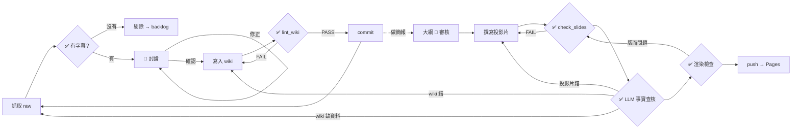

# 御宅藝 LLM Wiki（wotagei-llm-wiki）

入口頁：**https://hibikidad.github.io/wotagei-llm-wiki/**

## 1. Wiki 主題與介紹

**主題：御宅藝（ヲタ芸 / Wotagei）及其周邊文化**
包括地下偶像、地下藝、表演藝、打call 與 MIX、家虎、螢光棒、技、曲子結構與各段落的打法，以及厄介爭議。

我是御宅藝社團的成員，這個 wiki 是為社課「御宅藝文化講座」（120 分鐘）準備的知識庫。
這個主題的資料很分散，散落在日文維基、中文維基、YouTube 教學影片、圈內團體網站和廠商網站，
而且很多圈內知識根本沒有書面來源（例如「一般應援／地下藝／表演藝」的三分法）。

做法是 Karpathy 的 **LLM Wiki pattern**：
- **raw/**：原始資料，不可修改。
- **wiki/**：由 Claude Code 撰寫、維護。
- **CLAUDE.md**：schema，規定頁面格式與流程。

每份來源 ingest 時都「先討論、後生成」：Claude 先列出重點，我確認或修正之後才寫入。
我的修正記錄成來源 **S00**，和書面來源衝突時兩邊並列。

| 規模 | |
|---|---|
| 外部來源 | 11 份（S01～S11，共 20 個來源頁；YouTube 只收有字幕的，另剔除 19 支無字幕影片） |
| wiki 頁面 | 56 頁：概念 10、技 15、道具 1、曲子結構 1、歷史 1、文化 3、來源 20、產出 1，加上 overview、glossary、index、log |
| 操作紀錄 | 22 筆 log、23 次自動 lint、1 次 LLM lint |
| 簡報 | 33 張投影片，每張都用 `data-sources` 標出依據的 wiki 頁 |

## 2. Wiki 連結

- 目錄：[wiki/index.md](wiki/index.md)（GitHub：https://github.com/HibikiDad/wotagei-llm-wiki/blob/main/wiki/index.md ）
- 新手入口：[wiki/overview.md](wiki/overview.md)　用語表：[wiki/glossary.md](wiki/glossary.md)　操作紀錄：[wiki/log.md](wiki/log.md)
- Schema：[CLAUDE.md](CLAUDE.md)

> 也可以用 Obsidian 打開 `wiki/` 資料夾瀏覽（頁面之間都是相對路徑的 Markdown 連結）。

## 3. 簡報連結

**https://hibikidad.github.io/wotagei-llm-wiki/slides/**

- 原始檔：[slides/index.html](slides/index.html)
- 操作：← → 或空白鍵換頁。
- 涵蓋：御宅藝的定義與三分法、歷史、地下偶像與台灣圈、螢光棒、曲子結構、打call／MIX／家虎、技的實作、禮儀與厄介。
- 內含 5 支 YouTube 影片。其中第 6 張的影片被上傳者限制在外部網站播放，所以改成「在 YouTube 開啟」的連結卡。

## 4. Loop／Graph 圖與說明

完整說明與圖：**[docs/workflow.md](docs/workflow.md)**。



**哪些步驟會重複**
- 每份來源都走一次 Ingest loop。
- 討論會重複到我確認為止。
- lint 失敗就修到通過為止。
- 投影片的檢查失敗會回到撰寫那一步。

**檢查和重新生成發生在哪裡、為什麼**
- **🧑 討論放在寫入之前**：圈內知識常常和書面來源不同，寫入前修正只要改一次，寫入後再改會擴散到很多頁。
- **自動 lint 放在 commit 之前**：確定性的錯誤（斷鏈、缺出處、用語）用腳本最快，放在 commit 前可以保證 git 裡每個版本都通過檢查。
- **便宜的檢查先跑**：check_slides（幾秒）→ LLM 事實查核（逐張比對）→ 渲染檢查（瀏覽器截圖）。
- **事實查核有三種重新生成**：投影片錯就重寫該張；wiki 錯就先修 wiki 再重寫；wiki 缺資料就回 Ingest。
  只修投影片不修 wiki 的話，下次產出還是錯的。
- **渲染檢查修完要回到 check_slides 並重新截圖**，因為修正本身可能造成新問題，這次就發生了。

## 5. 一次真實執行與檢查紀錄

### (a) Ingest：S06 無用男Rain MIX／家虎講座（16:30～16:42，commit `3162a11`）

| 步驟 | 發生了什麼 | 紀錄 |
|---|---|---|
| 抓取 | 3 支影片中，S06a（IgyO088HTH8）**沒有字幕 → 剔除**；S06b、S06c 有字幕 | [raw/backlog.md](raw/backlog.md) |
| 🧑 討論 | 我**修正了 S05 討論時的結論**：「打call」不是專指一般應援，而是總稱，地下藝和 MIX 都包含在內；MIX 不是地下藝專有；另外提供了一篇 kknews 文章 | [S00 討論紀錄 §S06](wiki/sources/S00-discussion-notes.md) |
| 寫入 | 新增 call、mix、song-structure 等頁；kknews 插入成 S07，祈哥順延成 S08，各頁的「待 S0x」一併更新 | [log](wiki/log.md) |
| ✅ lint（第 1 次） | **❌ FAIL**：E5 ×2，S06c 來源頁直接寫了不採用的「耶太嘎」「愛孥語」 | [lint-20261123-164053.md](checks/lint-20261123-164053.md) |
| 修正 | 改成標準寫法，原文放進全形括號註記 | |
| ✅ lint（第 2 次） | **✅ PASS** | [lint-20261123-164221.md](checks/lint-20261123-164221.md) |
| 記帳 | 更新 index、log，commit | `3162a11` |

### (b) Slides Graph 第 3～5 步（17:30～17:41，commit `93e748e`、`b941cc9`）

| 步驟 | 結果 | 紀錄 |
|---|---|---|
| 3 check_slides | PASS。工具先用故意埋錯的副本做反向測試，4 類錯誤都抓到，也修了工具本身的相對路徑 bug | [slides-check-20261123-173025.md](checks/slides-check-20261123-173025.md) |
| 4 LLM 事實查核 | 約 120 條陳述，**5 個問題**。投影片寫錯 3 個 → 重寫；**wiki 過時或漏寫 2 個 → 先修 wiki**（yetta-tiger 沒跟上 S10 討論的場合區分） | [slides-factcheck-20261123.md](checks/slides-factcheck-20261123.md) |
| 5 渲染檢查 | 33 張腳本量測加截圖，**4 個問題**：角色遮字、S05 影片限制外部播放、缺影片備援、缺 favicon。修正時又產生 1 個副作用（影片被撐寬），重新截圖時發現並修正 | [slides-render-20261123.md](checks/slides-render-20261123.md)、[截圖](checks/render-20261123/) |
| 回到 3 | 修完重跑 check_slides：PASS | [slides-check-20261123-174054.md](checks/slides-check-20261123-174054.md) |

所有檢查報告：[checks/](checks/)

## 6. 反思

完整內容：**[docs/reflection.md](docs/reflection.md)**。

- **最常失敗的節點：「寫入 wiki」**，失敗方式有兩種。
  - **用語錯誤**：23 次 lint 有 3 次 FAIL，全部是 E5，都是引述來源時照抄原文寫法。lint 馬上就抓到，代價低。
  - **我的修正沒有擴散到所有頁面**：至少 6 處。例如「台灣以 LED 為主」只修了一頁、overview 殘留舊的厄介定義、yetta-tiger 沒跟上場合區分。
    這些一路漏到 LLM lint、寫簡報前、甚至事實查核才被發現，代價高。
- **把檢查往前移**：
  - 用語對照 glossary，從「寫完後的 lint」移到「🧑 討論時」。
  - 「被推翻的舊說法」在討論時就列出來，寫入時 `grep` 全 wiki（一定包含 overview）一起改。
  - 字幕檢查移到規劃來源時。
  - 以上已寫回 [CLAUDE.md](CLAUDE.md) §3.1。
- **工作流程的改變**：
  - 新增 S00 討論紀錄，讓沒有書面來源的圈內知識也能追溯。
  - 大綱審核時發現資料不夠，倒回 Ingest 補了 S09～S11。
  - 渲染檢查從只看截圖，改成腳本量測加截圖。
  - log 時間兩次寫成估計值，之後改為一律用 `date` 取得。

## 目錄

```
raw/        原始資料（維基百科全文；其他來源只放後設資料與短引文，全文 *.private.md 不進 repo）
wiki/       LLM 維護的 wiki
tools/      fetch_web.py、fetch_youtube.py、lint_wiki.py、check_slides.py（Python）
checks/     每次檢查的報告
slides/     HTML 簡報
docs/       workflow.md、reflection.md
CLAUDE.md   schema
```

## 授權與版權

- 維基百科內容（S01～S04）依 CC BY-SA 4.0。
- 其他網站與 YouTube 逐字稿的全文只保存在本機，repo 只放網址、標題、作者等後設資料與 ingest 時摘錄的短引文。
- 簡報中的影片以 YouTube 官方嵌入播放。
