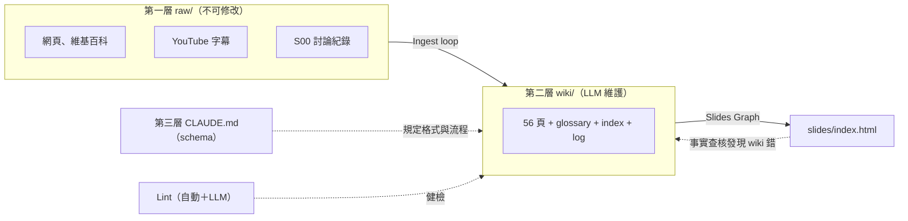
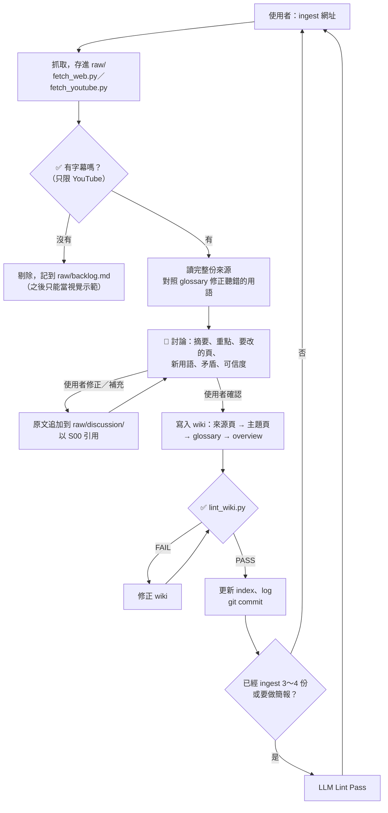
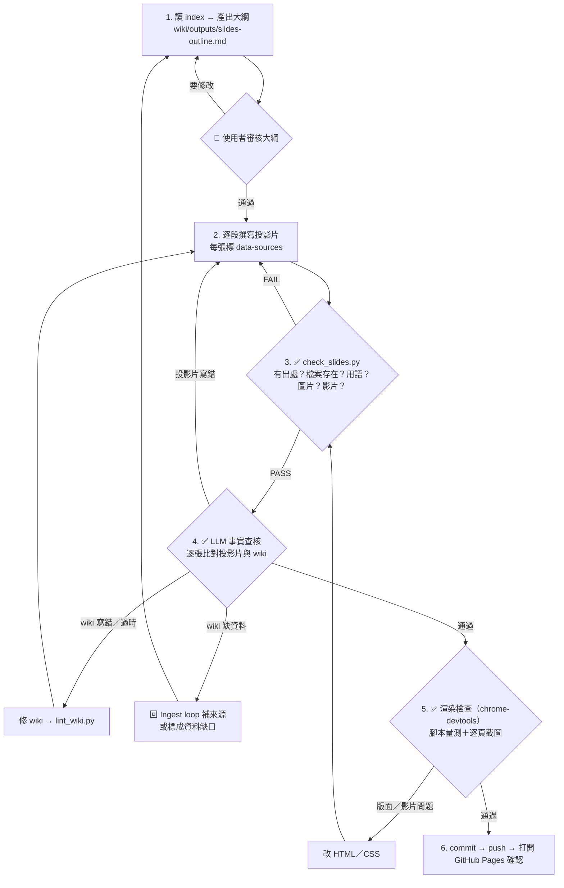

# 工作流程設計：Loop 與 Graph

這份文件說明本專案的三個流程：**Ingest loop**、**Lint**、**Slides Graph**。
重點在三件事：哪些步驟會重複、檢查和重新生成發生在哪裡、為什麼放在那裡。
完整的步驟規格寫在 [CLAUDE.md §3](../CLAUDE.md)。圖中的 🧑 代表要停下來等使用者，✅ 代表檢查節點。

## 總覽

## 1. Ingest loop（一次一份來源）

**會重複的步驟**

| 迴圈 | 重複什麼 | 什麼時候停 |
|---|---|---|
| 外層 | 每份來源都走一次「抓取 → 討論 → 寫入 → 檢查 → commit」 | 來源足夠支撐簡報大綱 |
| 討論 | 使用者修正後，Claude 把修正寫回重點再確認一次 | 使用者說「可以」 |
| 檢查 | `lint_wiki.py` FAIL → 修 → 重跑 | Error 為 0 |

**檢查與重新生成放在哪裡、為什麼**

- **字幕檢查放在抓取之後、閱讀之前**：沒有字幕就沒有可引用的文字，越早剔除越省事。
  S06a 就是在這一步被剔除的。
- **🧑 討論放在寫入之前**（「先討論、後生成」）：
  - 這個主題有很多圈內知識沒有書面來源，例如「應援型 ≠ 地下藝」「打call 是總稱」。
  - 如果先寫再改，錯的分類會擴散到很多頁；在寫入前修正，只要改一次。
  - 使用者的修正存成 S00，所以「這句話是誰說的」可以追溯。
- **自動 lint 放在每次寫入之後、commit 之前**：
  - 斷鏈、缺出處、誤用不採用寫法這類問題是確定性的，用腳本檢查又快又不會漏。
  - 放在 commit 之前，git 歷史裡的每個版本都是通過檢查的。
- **LLM Lint 每 3～4 次 ingest 跑一次**：跨頁矛盾、過時說法這類問題要讀過很多頁才看得出來，
  每次都跑太貴，完全不跑又會累積。所以固定在做簡報之前一定跑一次。

## 2. Lint（健檢）

| | 自動（`tools/lint_wiki.py`） | LLM（`checks/lint-llm-*.md`） |
|---|---|---|
| 檢查 | E1 缺 frontmatter、E2 斷鏈、E3 缺出處、E4 沒列進 index、E5 誤用不採用寫法、E6 引用不存在的來源、W1 孤兒頁、W2 缺「相關頁面」 | 跨來源矛盾、過時說法、被提到卻沒有頁面的概念、資料缺口 |
| 時機 | 每次寫入 wiki 之後 | 每 3～4 次 ingest、做簡報前 |
| 失敗時 | 修到 PASS 才能 commit | 修 wiki，或把缺口標成「⚠️ 資料缺口」，或回 Ingest 補來源 |
| 這次的結果 | 23 次，3 次 FAIL（全是 E5） | 5 個矛盾、3 類過時說法、6 個資料缺口，修了 8 頁 |

## 3. Slides Graph（wiki → 簡報）

**三條回頭重新生成的路**

1. **投影片寫錯 → 重寫該張**：例如把ロマンス列成副歌技、年表順序錯。
2. **wiki 寫錯或過時 → 先修 wiki，再從 wiki 重寫投影片**：
   - 例如 yetta-tiger.md 沒有跟著 S10 討論更新。
   - 只改投影片不改 wiki 的話，下一次從 wiki 產出的東西還是錯的，所以一定先修源頭。
3. **wiki 缺資料 → 回到 Ingest**：
   - 大綱審核時發現缺台灣圈團體與厄介的資料，就回去 ingest 了 S09、S10、S11，再修訂大綱。
   - 不能補的就在投影片上明講「wiki 缺資料」，不用模型自己的知識硬補。

**為什麼檢查是這個順序**

| 步驟 | 檢查什麼 | 為什麼放在這裡 |
|---|---|---|
| 1 🧑 大綱審核 | 章節、時間配置、範圍 | 還沒寫任何投影片，修改成本最低；使用者在這一步決定「年表少一點、台灣圈團體多一點」 |
| 3 check_slides | 出處存在、用語、圖片、影片是否 ingest | 確定性、幾秒就跑完 → 放在昂貴的 LLM 查核之前，先把機械性錯誤濾掉 |
| 4 LLM 事實查核 | 投影片上的每個陳述在 wiki 裡找得到 | 腳本只知道「有沒有列出處」，不知道「內容對不對」；這一步才能發現 wiki 本身過時 |
| 5 渲染檢查 | 溢出、遮擋、圖片、影片能否播放 | 內容確定後才排版，否則改內容又要重排；遮擋和影片限制只有在瀏覽器裡才看得到 |
| 6 線上確認 | GitHub Pages 的路徑、Jekyll | 本機能開不代表線上能開（相對路徑、`.nojekyll`） |

渲染檢查修完要**回到第 3 步**重跑 check_slides，再重新截圖。
這次修第 6 張的影片時就引入了新的版面問題（見 [slides-render](../checks/slides-render-20261123.md)）。

## 相關檔案

- 規格：[CLAUDE.md](../CLAUDE.md)
- 工具：[lint_wiki.py](../tools/lint_wiki.py)、[check_slides.py](../tools/check_slides.py)、[fetch_web.py](../tools/fetch_web.py)、[fetch_youtube.py](../tools/fetch_youtube.py)
- 檢查紀錄：[checks/](../checks/)
- 反思：[reflection.md](reflection.md)
